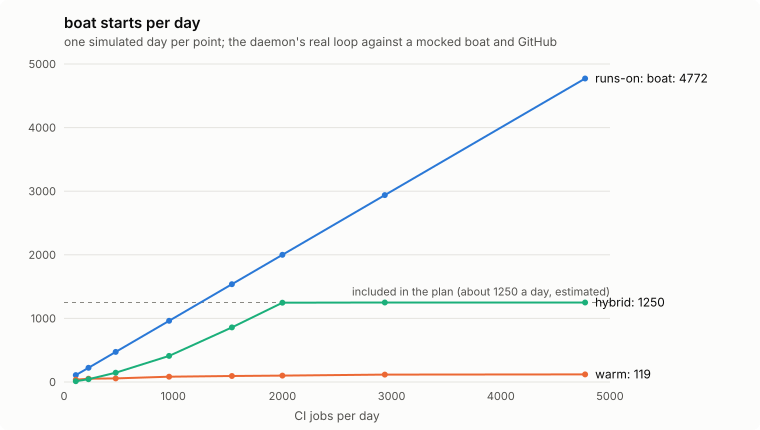

# sw-boat-runner

A daemon that runs self-hosted GitHub Actions runners on [boat](https://boat.dev)
machines and reuses the machines across jobs.

We love boat and keep using it. Its managed `runs-on: boat` is the simplest way to run
CI there, but it starts a machine for every job, and a busy repository runs more jobs in
a day than its plan includes starts. This daemon keeps machines up between jobs, stops
them when idle, and forks a fresh one only when a job needs it.



| Jobs a day | Setup | Starts | Paid starts | Queue p50 / p90 |
| - | - | - | - | - |
| 962 | `runs-on: boat` | 962 | 0 | 8 s / 8 s |
| | `warm` | 84 | 0 | 18 s / 26 s |
| 2,000 | `runs-on: boat` | 2,000 | 750 | 8 s / 8 s |
| | `warm` | 101 | 0 | 17 s / 24 s |
| 4,772 | `runs-on: boat` | 4,772 | 3,522 | 8 s / 8 s |
| | `warm` | 119 | 0 | 17 s / 24 s |

The numbers come from `cargo run --release --example bench`, which simulates a day of CI.
`runs-on: boat` is mocked as one start per job; the daemon's real loop runs against a
mocked boat and GitHub API. Under the plan's included starts, `runs-on: boat` is cheaper
and starts jobs sooner. Past them, each of its jobs is a paid start. The included starts
(1,250 a day) are an estimate from one bill, not boat's published number.
[bench/](bench/) has the assumptions, the other presets and the cost columns.

## Connect a repository

The daemon is one process for one repository. It keeps no database, so it runs on any
host that stays up and can be restarted at any time.

1. Install it:

   ```sh
   cargo install --locked --git https://github.com/Surely-Works-LLC/sw-boat-runner
   ```

2. Make a boat snapshot with an extracted
   [actions/runner](https://github.com/actions/runner) release at
   `/home/user/actions-runner`, its dependencies, and whatever your jobs expect to find.
   Leave the runner unconfigured. Keep logins and tokens out: a job can read every file
   in the snapshot. Remove cleanup timers, because machines keep the snapshot's systemd
   timers.

3. Set two environment variables:

   | Variable | Value |
   | - | - |
   | `BOAT_API_KEY` | A boat key for the account that owns the snapshot. |
   | `GITHUB_TOKEN` | A fine-grained personal access token for the repository with Administration read and write (to register runners) and Actions read (to see queued jobs). |

   The `GITHUB_TOKEN` that GitHub Actions creates for each workflow run does not work:
   it cannot be given Administration, so it cannot register runners.

4. Write `policy.toml`:

   ```toml
   repo = "acme/app"

   [[pool]]
   name = "ci"
   labels = ["self-hosted", "large"]
   machine_type = "large"
   snapshot = "snap-1"
   max_boxes = 4
   ```

5. Check it, see what it would do, then run it:

   ```sh
   sw-boat-runner check policy.toml   # validate, print each pool with its preset applied
   sw-boat-runner plan policy.toml    # observe once, print the actions as JSON; changes nothing
   sw-boat-runner run policy.toml     # the loop
   ```

6. Point jobs at the pool. A job goes to the first pool whose `labels` include all of
   its `runs-on` labels:

   ```yaml
   runs-on: [self-hosted, large]
   ```

The daemon creates machines with `noEnv`, so boat adds none of the account's secrets. It
labels its machines `sw-boat-runner=<pool>`, names its runners `sbr-<pool>-...`, and
ignores every other machine and runner. To update the runner, rebuild the snapshot.

[examples/self-hosted/](examples/self-hosted/) is a complete setup: this repository's
[`self-hosted` workflow](.github/workflows/self-hosted.yml) has the daemon fork a machine
for its own tests.

## Policy

`repo` and `tick_s` (default 15) sit at the top level. Each `[[pool]]` takes:

| Field | Default | Meaning |
| - | - | - |
| `name` | required | Lowercase letters, digits and `_`. |
| `labels` | required | Runner labels. Must include `self-hosted`. |
| `machine_type` | required | `small`, `default`, `large` or `xlarge`. |
| `snapshot` | required | The boat snapshot machines start from. |
| `max_boxes` | required | Most machines up or starting at once. |
| `preset` | `hybrid` | See below. |
| `placement` | from the preset | Overrides the preset's steps. |
| `min_up` | 1 for `pool`, else 0 | Kept machines that stay up without jobs. |
| `slots_per_box` | 1 | Runners per kept machine. |
| `idle_stop_s` | 1800 | Idle time before a kept machine stops. |
| `min_up_s` | 600 | Shortest time a machine stays up before it may stop. |
| `register_timeout_s` | 300 | How long a registered runner may take to come online. Keep it above the time boat takes to copy the snapshot to a new machine's disk. |
| `fork_ttl_s` | 3600 (at most 2592000) | Longest life of a machine forked for one job. |
| `paid_start_cents_per_day` | 0 | Daily cap on paid starts. 0 means only starts the plan includes. |

A preset sets `placement`, the ways to find a runner for a queued job, tried in order:

| Preset | Placement | Idle machines |
| - | - | - |
| `pool` | `slot` | `min_up` stay up |
| `warm` | `slot, resume` | stopped after `idle_stop_s`, resumed for the next job |
| `fork` | `fork` | none; each job gets a new machine that is deleted afterwards |
| `hybrid` | `slot, resume, fork` | like `warm`, and forks for bursts |

Use `fork` for untrusted code such as pull requests from forks.
[docs/design.md](docs/design.md) has the full design.

## Verification

[spec/BoatRunner.tla](spec/BoatRunner.tla) models the loop together with boat, GitHub,
crashes, timeouts and listing lag. TLC checks that no machine is stopped while its runner
runs a job, a pool never exceeds `max_boxes`, paid starts stay within the daily cap across
restarts, no job gets two machines, a `fork` pool never runs two jobs on one machine,
queued jobs get a runner, and idle machines stop. [spec/README.md](spec/README.md) lists
what the model leaves out, the bugs it found, and
[how to run TLC](spec/README.md#running-tlc). Property tests check `decide` against the
safety properties, and the loop is tested against a fake transport.

## Status

In November 2026 a `fork` pool ran against a production repository: it forked machines up
to `max_boxes`, each machine's runner took one job, and the daemon deleted the machines
and their runners afterwards. [eval/](eval/) measures a repository's move from
`runs-on: boat` to persistent boat runners, which is the setup this daemon automates.

## License

MIT or Apache-2.0, at your option. See [LICENSE-MIT](LICENSE-MIT) and
[LICENSE-APACHE](LICENSE-APACHE).
